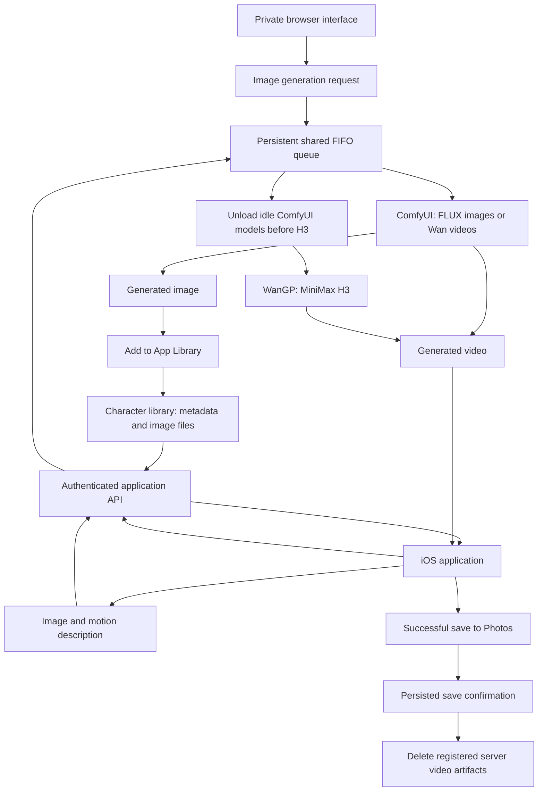

# ABDVideoAI — Development Report and Operating Capacity

This report summarizes the implementation, troubleshooting, and observed behavior documented during the project sessions on October 15–16, 2026. The video application and parts of the server infrastructure already existed at the first inspection. This is a record of the work verified during those sessions, rather than a claim to reconstruct every earlier development step.

ABDVideoAI combines locally hosted image and video generation with an iPhone application and a private browser interface. It uses existing pretrained models; no foundation model was trained from scratch during this work.

## 1. What Was Built

- A private browser interface for generating still images from text and optional image references.
- An iOS workflow for choosing a character or uploading an image, describing its movement, and generating a video.
- A server-backed character library with names, categories, thumbnails, and full-resolution images.
- An **Add to App Library** action next to the generated-image download button.
- A persistent FIFO queue shared by image generation and both video engines.
- A five-minute cooldown after verified task completion.
- Automatic unloading of idle ComfyUI models before starting an H3 video task.
- A delivery-confirmation mechanism that requests server-side video deletion only after a successful save to the iPhone photo library.
- A custom application icon and revised interface copy that separates video duration from generation time.

The iOS creation interface now requires an image. Users can choose one from the server library or their device. The text-only video option was removed from the client interface after a successful reference-image animation test. This change does not remove the underlying server engine's text-to-video capabilities.

## 2. Server Hardware and Software

The following values were observed during inspection; available capacity changes as workloads run.

| Component | Observed configuration |
|---|---|
| Operating system | Ubuntu 24.04 LTS; reported release: 24.04.5 |
| GPU | NVIDIA GeForce RTX 3060 |
| GPU memory | 12,288 MiB, approximately 12 GB |
| System memory | Approximately 32 GB installed; Linux reported 31 GiB |
| Swap | 8 GiB |
| System filesystem | 468 GB reported capacity |
| Initially available disk space | Approximately 319 GB |
| GPU power limit | 170 W |
| Client platforms | macOS browser and native iOS application |
| Application stack | SwiftUI, Python, FastAPI, SQLite, and systemd |
| Private image-interface access | Tailscale |

The CPU model was not recorded, so this report does not assume one.

### Generation engines

| Workload | Engine and model |
|---|---|
| Still-image generation and reference editing | ComfyUI with FLUX.2 Klein Base 4B FP8, Qwen 3 4B text encoder, and FLUX.2 VAE |
| Video generation through ComfyUI | Wan 2.2 TI2V 5B |
| Video generation through WanGP | MiniMax H3 FL2VA Pruned 20B |

An SDXL checkpoint and additional video model files were also present. Their presence alone does not establish that they were used in the demonstrated workflows.

The initial image-generation directory occupied approximately **42 GB**, including approximately **36 GB of model files**. These are disk requirements, not runtime VRAM requirements.

## 3. System Architecture

The public-facing application API provides authenticated library reads. Publishing is handled by the private image interface; the video API does not expose a public library-publishing endpoint. Library images are stored separately from generated video artifacts.

## 4. Problems Encountered and Their Resolution

| Problem | Finding | Resolution or current status |
|---|---|---|
| Backup connection failed with `Permission denied (publickey)` | Connecting directly to the private IP did not use the Mac's existing SSH alias configuration. | Transfer commands were changed to use the established SSH alias. |
| A setup script stopped because its destination already existed | The generated files were already present. | Inspected and validated the existing files instead of overwriting them. |
| A copied URL appeared to contain Markdown | A read-only AST check confirmed the actual Python value was correct. | No URL change was necessary. This was a display/copy interpretation issue. |
| Image generation succeeded but the web page could not download it | A path check accepted a child directory but rejected the output directory itself. ComfyUI returned the image successfully. | Corrected the directory validation and recovered the existing result without generating it again. |
| Multi-paragraph video descriptions were rejected | The engine's prompt-processing mode interpreted line breaks as separate generation requests. | Used a single-paragraph description as a workaround. A general multiline-prompt fix was not implemented in this work. |
| Arabic prompts did not consistently preserve the requested animal | An early girl-and-camel request produced a different animal. | A more explicit English description improved the result. Anatomical details still require review. |
| A camel had an incorrect hump count | Prompt adherence was incomplete despite a recognizable camel. | Proposed a reference-based correction. A successful corrected output was not verified in the recorded session. |
| Generated text included unwanted marks | The image model added extra dots beneath the phrase. | Proposed an image-editing correction; exact typography remains a model limitation. |
| Images and video engines could compete for the same GPU | Separate application paths did not share a single execution gate. | Added a persistent shared queue and a single dispatcher. |
| Queue activation failed with a filesystem permission error | The service user could not create a new directory under a root-owned parent. | The installer restored the original code. A revised installer created only the new queue directories with sudo and assigned them to the existing service user. |
| H3 generation ran for more than 40 minutes without a completed output | H3 was active on the GPU, while ComfyUI retained most of the VRAM. No active swap churn was observed in the sampled interval. | Stopped the identified task on request, verified queue completion, and added an idle-model unloading gate before H3. The exact contribution to generation time remains unproven. |
| The interface implied that generation completed in five seconds | Five seconds described output duration, not processing time. | Reworded the header and added explicit duration and variable-generation-time information. |
| Example text and hardware details cluttered the user flow | The description was prefilled, the ending-text field contained an example, and engine copy discussed memory usage. | Cleared the examples and replaced hardware-oriented copy with quality/speed tradeoffs. |
| The character library was initially bundled inside the app | Adding characters required an application update. | Added a server catalog, authenticated image loading, pagination, categories, and private publishing. A new character appeared on the physical iPhone without another app update. |
| The app displayed “The network connection was lost” while generation continued | Client status polling failed, but the server task remained active. | Server-side persistence worked. Automatic client reconnection and clearer nonfatal status handling are still outstanding. |

## 5. Observed Operating Capacity

### Still images

- The prepared image workflows generate one image per request at **768 × 768**.
- Text-based generation and reference-image editing both produced usable results.
- A donkey reference retained its appearance while a blue hat was added.
- No controlled still-image latency benchmark was recorded.

### Video

- The configured H3 requests used a five-second duration, **480 × 832** resolution, 24 FPS, and 20 inference steps.
- One inspected reference-animation result was actually **640 × 640 at 24 FPS**, with a container duration of approximately **5.17 seconds**. Configured resolution should therefore not be presented as a verified invariant for every output.
- The donkey animation visibly removed its hat, approached the viewer, and made a kissing gesture while broadly preserving the reference character.
- Earlier video experiments were reported by the operator to take approximately **eight minutes**. This is an anecdotal observation, not a controlled benchmark or guaranteed response time.
- One H3 text-to-video request ran for more than 40 minutes before being stopped.
- A later identical-prompt diagnostic, after freeing ComfyUI memory, was stopped after approximately **5 minutes 22 seconds** without a completed video. Since it was cancelled, it cannot establish the full generation time or a speedup.

### GPU and memory behavior

At different points, monitoring showed:

- GPU utilization near **99–100%** during H3 computation.
- Total VRAM use around **11.6 GB out of 12 GB** before memory cleanup.
- ComfyUI retaining approximately **10 GB** despite having no active generation.
- H3 using approximately **28.5 GB of resident system memory** in one sample.
- No current swap-in/swap-out activity in the sampled ten-second interval, and zero recent memory-pressure averages at that moment. Allocated swap alone did not demonstrate an active swap bottleneck.
- Observed GPU temperatures ranging from approximately **26°C at idle to 60°C during one diagnostic**.
- Power readings approaching the configured **170 W** limit during some workloads.

After explicitly unloading idle ComfyUI models, total GPU memory fell from approximately **10 GB to 253 MB**, with the ComfyUI service still running under the same process ID. The persistent H3 gate now checks that ComfyUI is idle and requires at least **8 GiB of free VRAM** before starting H3.

H3 remained configured for a memory-saving profile that transfers model parts to the GPU. Freeing cached models is verified to recover VRAM; a corresponding reduction in total generation time has not yet been measured.

### Queue capacity and throughput

- **One coordinated GPU generation task at a time.**
- A maximum of **30 queued/active entries** in the current queue implementation.
- A **300-second cooldown** after verified completion, including known completed failures.
- Queued requests and the cooldown timestamp survive process restarts.
- If completion is uncertain, the queue blocks for review rather than starting overlapping work or blindly repeating a task.

Thirty accepted requests do **not** mean thirty simultaneous generations. This is a single-GPU system.

For planning only, if an eight-minute generation time were representative, an eight-minute task plus a five-minute cooldown would yield a theoretical ceiling of about **4.6 tasks per hour**, before overhead and failures. This is an illustrative calculation, not measured production throughput.

The queue coordinates the updated image page and video API. Direct use of other GPU applications does not automatically join this queue.

## 6. Character Library

The central library supports:

- Names and four categories: animals, people, scenes, and other.
- Full PNG images and small JPEG thumbnails.
- Authenticated catalog and image reads.
- Pagination and refresh in the iOS application.
- Duplicate detection based on image pixels and dimensions.
- Publication of completed image results through the private page.
- Separation from video cleanup, so saving a video does not remove a library character.

Current implementation limits are **1,000 images**, **80 characters per name**, **20 MB per image**, and validated image dimensions. These are application limits, not storage or hardware benchmarks.

The deployed library was verified on a physical iPhone. The initial characters and an additional published soldier image appeared in the catalog.

## 7. Video Delivery and Cleanup

The implemented sequence is:

1. Download the completed video to the application.
2. Save it to the iPhone photo library.
3. Wait for a successful Photos operation.
4. Persist a local confirmation receipt.
5. Send the confirmation to the server.
6. Delete the registered video artifacts while preserving job and credit records.

Download or sharing alone does not trigger deletion. Failed confirmations remain pending and can be retried. Duplicate confirmations are handled idempotently.

This behavior passed local automated tests. A separate production audit of successful album-save deletion was not documented, so it should not be reported as fully verified end to end on a real device.

## 8. Validation, Backups, and Deployment

- The queue/delivery update passed **34 local automated tests**.
- The library update passed **37 local automated tests**.
- Additional checks covered the memory-release gate, private-page controls, duplicate publication, seed imports, and installer rollback behavior.
- iOS simulator builds and signed physical-device builds succeeded.
- The server library and private page were activated and their read endpoints checked.
- The updated catalog was demonstrated on an actual iPhone.
- Database backups used SQLite's backup mechanism and passed integrity checks.
- Incremental application updates replaced only changed source files, rather than duplicating the entire project.
- Planned service restarts were limited to the components being updated. Verified ComfyUI and unrelated service process IDs remained unchanged during the relevant deployments.

Secrets, private host addresses, account identifiers, and backup contents are intentionally omitted from this report. Backups containing environment configuration must not be committed to a public repository.

## 9. Remaining Work

- Restore client polling automatically after a network interruption or application backgrounding.
- Persist and recover the active client job identity, and avoid duplicate submissions after ambiguous network failures.
- Replace a polling failure message with a clear indication that server generation may still be running.
- Measure complete video generation times under controlled settings for each engine and input type.
- Verify album-save confirmation and server cleanup on a physical device under normal and interrupted connections.
- Improve prompt handling for multiline descriptions.
- Add better visibility into actual model progress instead of relying on periodic “still running” messages.
- Measure concurrent user demand, queue wait times, and storage growth before defining a production service-level target.

## Project Status

The project has demonstrated local image generation, reference editing, image-to-video animation, shared GPU scheduling, and a server-backed character library connected to an iPhone application. GPU memory recovery before H3 is verified. H3 latency and automatic client recovery remain unresolved performance and usability issues; no guaranteed generation time is claimed.
